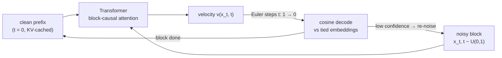

# DLLM

A minimal **block-diffusion language model** in ~1k lines of PyTorch.
It denoises continuous token embeddings with flow matching: tokens are generated block by block, and all tokens in a block are denoised in parallel.



## Techniques

| Area | What's in it |
| --- | --- |
| **Objective** | Continuous embedding diffusion · rectified flow `x_t = (1-σ)(1-t)·x₀ + t·ε` · velocity MSE on block positions only |
| **Block diffusion** | BD3-LM style: clean prefix + one noisy block per window; AR across blocks, parallel within a block (`block_len == window` → pure diffusion) |
| **Backbone** | Pre-norm RMSNorm · RoPE · QK-norm · SwiGLU · SDPA · sinusoidal per-position timestep embedding |
| **Decoding** | Tied embeddings + cosine-similarity logits · Euler block sampler (Heun for whole-sequence) · KV cache across blocks |
| **Guidance** | Classifier-free guidance from prefix dropout (p = 0.1) |
| **Adaptive refine** | Mercury-style: re-noise tokens below a confidence threshold, keep confident ones anchored |
| **Training** | AdamW (0.9, 0.95) · warmup + cosine LR · grad clip 1.0 · EMA 0.999 (used for sampling) · optional bf16 autocast |
| **Data** | ByteLevel BPE (8k vocab, trained on the corpus) · TinyStories / WikiText-2 / Tiny Shakespeare / any `.txt` |

## Quickstart

```bash
uv sync
uv run pytest                                          # ~1 s smoke tests, offline
uv run dllm-train configs/debug.yaml                   # tiny end-to-end run on CPU
uv run dllm-train configs/tinystories.yaml             # the README sample run
uv run dllm-sample runs/tinystories/final.pt steps=32 guidance_scale=1.0
```

Configs are typed dataclasses (`config.py`) with YAML presets in `configs/`. Override anything with `section.key=value`, e.g. `optim.lr=1e-3 data.block_len=32 run.out_dir=runs/exp1`. Each run writes its resolved `config.yaml` next to the checkpoints, and `dllm-sample` reuses it, so bare keys like `steps=32` override only the sampling settings. `dllm-train --help` prints every key with its default.

## Sample

7.9M params (d=256, 6 layers), 6k steps on 15k TinyStories docs, 64 steps/block, T = 0.9:

> okay knewMmm gone take soap Tim swings Her swings wind cry safari memb owl harm goOkay swing King makes Mia even birdhouse that eyes whiteirl understand work Lily stealing steering set flexible suggest know onto woods trees again Mommy, heardOkay …

It has picked up the TinyStories vocabulary (names, *Mommy*, *swings*, *birdhouse*) but no grammar yet. Coherent text needs a larger model and much more training.

## Layout

```
configs/           # YAML presets: debug, tinystories
tests/             # smoke tests (config, shapes, KV cache == recompute, train → sample)
src/diffusion_llm/
├── config.py      # dataclass schema + YAML / CLI merging
├── model.py       # Transformer backbone, cosine decode
├── diffusion.py   # flow-matching path, loss, Heun sampler
├── generation.py  # block decoding, KV cache, CFG, adaptive refine
├── train.py       # training loop, EMA, checkpoints
├── sample.py      # sampling CLI
├── tokenizer.py   # BPE tokenizer
└── dataset.py     # corpora + window dataset
```

`uv run ruff check . && uv run pyrefly check && uv run pytest` (all clean).
